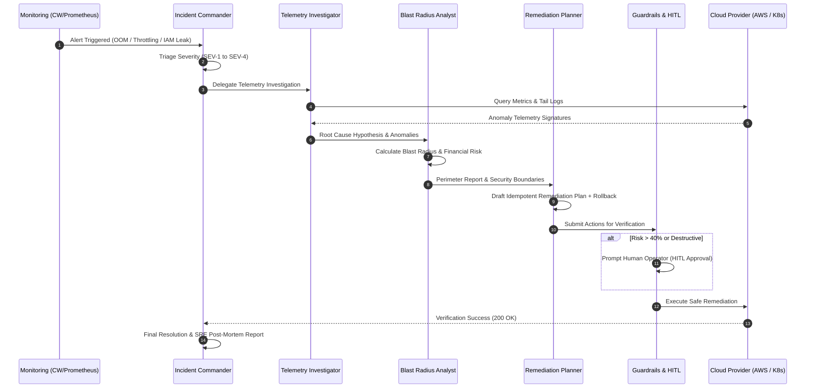

<h1 align="center">⚡ CloudAgentSwarm</h1>
<p align="center">
  <b>Autonomous Multi-Agent Cloud SRE &amp; Incident Commander for AWS &amp; Kubernetes</b>
</p>

<p align="center">
  <a href="https://github.com/ekrmcakir/cloud-agent-swarm/actions/workflows/ci.yml">
    
  </a>
  <a href="https://github.com/ekrmcakir/cloud-agent-swarm/releases/tag/v1.0.0">
    
  </a>
  
  
  
  
  
  
</p>

---

## 📑 Table of Contents

- [🎯 Overview](#-overview)
- [⚡ Key Capabilities](#-key-capabilities)
- [🤖 The Swarm Agent Roster](#-the-swarm-agent-roster)
- [🔄 Swarm Architecture & Lifecycle](#-swarm-architecture--lifecycle)
- [🛡️ Zero-Guess Safety, Guardrails & HITL](#️-zero-guess-safety-guardrails--hitl)
- [🔥 Chaos Scenarios Catalog](#-chaos-scenarios-catalog)
- [🖥️ Cockpit CLI & Terminal Walkthrough](#️-cockpit-cli--terminal-walkthrough)
- [🔌 Model Context Protocol (MCP) Integration](#-model-context-protocol-mcp-integration)
- [🚀 Quick Start & Installation](#-quick-start--installation)
- [🐳 Production Deployment (Docker & Helm)](#-production-deployment-docker--helm)
- [⚙️ Configuration Reference](#️-configuration-reference)
- [🧪 Test Suite & Quality Assurance](#-test-suite--quality-assurance)
- [📜 License](#-license)

---

## 🎯 Overview

**CloudAgentSwarm** is an enterprise-grade autonomous multi-agent incident response platform engineered to triage, investigate, contain, and remediate cloud infrastructure outages in seconds.

Modern cloud outages in distributed architectures (AWS, EKS, multi-region meshes) are too complex for monolithic runbooks or single-prompt LLM scripts. Hallucinations and unconstrained mutations can turn an isolated pod failure into a cross-account catastrophe.

`CloudAgentSwarm` solves this by orchestrating a **specialized multi-agent cognitive loop**:
1. An **Incident Commander** triages urgency and coordinates consensus.
2. A **Telemetry Investigator** extracts deterministic root causes from Prometheus, CloudWatch, and container logs.
3. A **Blast Radius Analyst** calculates security perimeters, VPC crossover, and financial exposure.
4. A **Remediation Planner** synthesizes atomic actions paired with guaranteed inverse rollback commands.
5. Strict **AST Guardrails** and **Human-in-the-Loop (HITL)** gates ensure no destructive mutations occur without explicit authorization.
6. A professional **SRE Post-Mortem** report is published automatically upon resolution.

```
                     ┌───────────────────────────────┐
                     │  CloudWatch / Prometheus Alert │
                     └───────────────┬───────────────┘
                                     │ (Event: incident.detected)
                                     ▼
                     ┌───────────────────────────────┐
                     │      Incident Commander       │
                     │  (Triage, SEV score, Quorum)  │
                     └───────────────┬───────────────┘
                                     │
                                     ▼
                     ┌───────────────────────────────┐
                     │     Telemetry Investigator    │
                     │ (Metrics, CloudTrail, Traces) │
                     └───────────────┬───────────────┘
                                     │ (Root Cause Hypothesis)
                                     ▼
                     ┌───────────────────────────────┐
                     │     Blast Radius Analyst      │
                     │   (IAM, Network, Financial)   │
                     └───────────────┬───────────────┘
                                     │ (Risk Score & Perimeter)
                                     ▼
                     ┌───────────────────────────────┐
                     │      Remediation Planner      │
                     │  (Playbooks, Rollback, RTO)   │
                     └───────────────┬───────────────┘
                                     │
                                     ▼
                     ┌───────────────────────────────┐
                     │    Guardrail Verification     │
                     └───────────────┬───────────────┘
                                     │
                                     ▼
                     ┌───────────────────────────────┐
                     │    Human-in-the-Loop Check    │ (If Risk > 40% or Destructive)
                     └───────────────┬───────────────┘
                                     │ (Approved)
                                     ▼
                     ┌───────────────────────────────┐
                     │   Safe Remediation Executor   │
                     └───────────────┬───────────────┘
                                     │
                                     ▼
                     ┌───────────────────────────────┐
                     │   Post-Mortem & Audit Trail   │
                     └───────────────────────────────┘
```

---

## ⚡ Key Capabilities

- **Sub-Second MTTR Acceleration:** Autonomous investigation, correlation, and remediation plan generation in `< 1.5 seconds`.
- **Zero-Guess Safety Perimeter:** Hardcoded policy guardrails prevent catastrophic commands (`drop_database`, `delete_vpc`, `destroy_kms_key`).
- **Human-in-the-Loop (HITL) Checkpoints:** Actions with risk score $> 40.0$ or flagged as destructive mandate interactive human approval before execution.
- **Rollback Guarantee:** No action can be dispatched without an exact, verified inverse rollback command.
- **Event-Driven & Declarative State Machine:** Backed by an in-memory asynchronous `EventBus` with ring-buffer memory limits, dead-letter queue (DLQ), and `SwarmGraph` state machine.
- **Model Context Protocol (MCP) 2.x:** Native stdio JSON-RPC server allowing Claude Desktop, Cursor, and Antigravity agents to drive investigations directly.
- **High-Fidelity Chaos Simulator:** 4 built-in scenarios (Kubernetes OOMKilled cascade, DynamoDB RCU throttling, privileged IAM credential leak, cross-AZ split brain).
- **Graceful Cloud Connectors:** Dual-mode architecture that connects to live AWS CloudWatch/Logs and Kubernetes API when available, falling back gracefully to deterministic emulation.

---

## 🤖 The Swarm Agent Roster

Each agent in the swarm operates with independent working memory, specialized cognitive prompts, and deterministic validation rules:

| Agent Role | Persona | Key Responsibilities | Primary Protocol Verbs |
|---|---|---|---|
| **Incident Commander** | `Commander-Prime` | War room leadership, initial triage, SEV-1 to SEV-4 classification, consensus verification, resolution sign-off. | `TRIAGE_RESPONSE`<br>`INCIDENT_RESOLVED`<br>`APPROVAL_REQUEST` |
| **Telemetry Investigator** | `Telemetry-Investigator-01` | Analyzes CloudWatch metrics, PromQL vectors, and container log streams to detect anomalies and derive a root cause hypothesis. | `TELEMETRY_ANOMALY_FOUND`<br>`INVESTIGATE_REQUEST` |
| **Blast Radius Analyst** | `Blast-Radius-Sentinel` | Evaluates IAM privilege escalation, VPC boundary crossovers, cascading failure risks, and financial loss exposure. | `BLAST_RADIUS_EVALUATED`<br>`BLAST_RADIUS_REQUEST` |
| **Remediation Planner** | `Remediation-Architect` | Synthesizes minimal-blast-radius remediation actions with realistic RTO estimations and exact rollback commands. | `PROPOSE_REMEDIATION`<br>`EXECUTE_REMEDIATION` |

---

## 🔄 Swarm Architecture & Lifecycle



---

## 🛡️ Zero-Guess Safety, Guardrails & HITL

CloudAgentSwarm adheres to the principle of **Zero-Guess Safety**. Remediation actions undergo multi-tiered scrutiny before touching production:

```
[Agent Proposes Plan]
         │
         ▼
[GuardrailEnforcer] ─── Violates Policy? ───► [ABORT INCIDENT + Alert SRE]
         │ (Passed)
         ▼
[Risk Evaluation]
   • Is Destructive?
   • Risk Score > 40.0?
   • Financial Exposure > $5,000?
         │
    Yes  │  No
 ┌───────┴───────┐
 ▼               ▼
[HITL Gating]  [Auto-Execution]
 (Awaiting SRE)          │
 │ (Authorized)          │
 └───────► [Execute] ◄───┘
               │
               ▼
   [Log Deterministic Rollback]
```

1. **Permanently Prohibited Actions:**
   - `drop_database`, `delete_vpc`, `purge_s3_bucket`, `destroy_kms_key`, `detach_all_internet_gateways`.
   - Any attempt instantly aborts the run without executing subsequent actions.
2. **Replica Quotas:**
   - `scale_deployment` cannot exceed `max_replicas_limit` (default: 50).
3. **Mandatory Rollback Command:**
   - Every action must declare its exact rollback command (e.g. `kubectl rollout undo deployment checkout-service-deployment`).
4. **Interactive Operator Prompt:**
   - If interactive terminal mode is active, the operator is prompted with an authorization dialog (`[y/N]`).

---

## 🔥 Chaos Scenarios Catalog

CloudAgentSwarm includes a built-in catalog of realistic cloud outages for testing and evaluation:

### 1. `oom_cascade` (SEV-1)
- **Target:** Kubernetes `checkout-service`
- **Trigger:** Memory usage spikes beyond 512Mi limit; container terminated with SIGKILL (Exit code `137`).
- **Remediation:** Scale replicas from 2 to 4, restart crashing pods with a 10s grace period.
- **Risk Score:** `35.0 / 100.0` (Contained to namespace).

### 2. `iam_key_leak` (SEV-1)
- **Target:** AWS IAM & S3 `prod-customer-vault`
- **Trigger:** Public commit leaks Administrator access key; unauthorized `GetObject` bursts from untrusted external IP.
- **Remediation:** Quarantine IAM access key, apply explicit S3 deny bucket policy.
- **Risk Score:** `88.0 / 100.0` (Security perimeter breached; mandates HITL approval).

### 3. `dynamodb_throttling` (SEV-2)
- **Target:** DynamoDB `order-events-table`
- **Trigger:** Flash sale burst exceeds provisioned 500 RCU; hot partition causes upstream cascading 504 timeouts.
- **Remediation:** Switch billing mode to `PAY_PER_REQUEST` (On-Demand auto-scaling).
- **Risk Score:** `45.0 / 100.0` (Requires HITL approval).

### 4. `split_brain_partition` (SEV-2)
- **Target:** AWS Transit Gateway `payment-transit-gateway`
- **Trigger:** Route table entry drift drops cross-AZ peering route `10.100.0.0/16`.
- **Remediation:** Restore TGW route entry, drain impacted AZ traffic.
- **Risk Score:** `60.0 / 100.0`.

---

## 🖥️ Cockpit CLI & Terminal Walkthrough

Run the built-in interactive terminal dashboard:

```bash
cloud-swarm simulate --scenario oom_cascade
```

```ansi
╔════════════════════════════════════════════════════════════════════════════╗
║                 CLOUD AGENT SWARM — SRE WAR ROOM COCKPIT                   ║
╚════════════════════════════════════════════════════════════════════════════╝

 Incident:   Kubernetes OOMKilled Cascading CrashLoop
 Severity:   SEV-1 | Status: MITIGATED
 Root Cause: Heap exhaustion in microservice cache layer

--- 🤖 Agent Swarm Dialogue Log ---
  [incident_commander    ] -> TRIAGE_RESPONSE          to: all
  [telemetry_investigator] -> TELEMETRY_ANOMALY_FOUND  to: incident_commander
  [blast_radius_analyst  ] -> BLAST_RADIUS_EVALUATED   to: incident_commander
  [remediation_planner   ] -> PROPOSE_REMEDIATION      to: incident_commander
  [incident_commander    ] -> INCIDENT_RESOLVED        to: all

--- 🛡️  Blast Radius & Security Perimeter ---
  Risk Score:            35.0 / 100.0
  VPC Crossed:           No (Contained)
  Human Approval Gated:  NO
  Financial Exposure:    $250.00

--- ⚡ Remediation Actions Executed ---
  1. [scale_deployment] on checkout-service-deployment
     Risk: LOW | Est. RTO: 25s | Rollback: kubectl scale deployment checkout-service-deployment --replicas=2
  2. [restart_pod] on checkout-service-pod-crashloop
     Risk: LOW | Est. RTO: 15s | Rollback: kubectl rollout undo deployment checkout-service-deployment

✔ Incident resolved and post-mortem generated successfully!
```

<details>
<summary><b>📄 Click to view generated Markdown Post-Mortem Report</b></summary>

```markdown
# SRE Incident Post-Mortem: Kubernetes OOMKilled Cascading CrashLoop
**Incident ID:** `inc-0fd02eba` | **Severity:** `SEV-1` | **Status:** `MITIGATED`

## 1. Executive Summary
- **Summary:** Checkout service pods hit memory limit of 512Mi due to sudden cache leak, cascading 502/504 errors across microservices.
- **Root Cause:** Heap exhaustion in microservice cache layer
- **Mean Time to Resolution (MTTR):** 1.2 seconds

## 2. Impact & Blast Radius Analysis
- **Risk Score:** `35.0/100.0`
- **VPC Boundaries Crossed:** No
- **Estimated Financial Exposure:** $250.00
- **Affected Services:** checkout-service, checkout-pod-replicas
- **Security Reasoning:** Application pod crashloop contained to stateless Kubernetes deployment.

## 3. Remediation Actions Executed
### Action 1: `scale_deployment` on `checkout-service-deployment`
- **Risk Level:** `LOW`
- **Estimated RTO:** 25s
- **Rollback Command:** `kubectl scale deployment checkout-service-deployment --replicas=2`
- **Parameters:** `{'replicas': 4}`

### Action 2: `restart_pod` on `checkout-service-pod-crashloop`
- **Risk Level:** `LOW`
- **Estimated RTO:** 15s
- **Rollback Command:** `kubectl rollout undo deployment checkout-service-deployment`
- **Parameters:** `{'grace_period': 10}`

## 4. Swarm Consensus Log
- `[incident_commander]` **TRIAGE_RESPONSE** -> all
- `[telemetry_investigator]` **TELEMETRY_ANOMALY_FOUND** -> incident_commander
- `[blast_radius_analyst]` **BLAST_RADIUS_EVALUATED** -> incident_commander
- `[remediation_planner]` **PROPOSE_REMEDIATION** -> incident_commander
- `[incident_commander]` **INCIDENT_RESOLVED** -> all

---
*Automated report generated by CloudAgentSwarm at 2026-11-17 14:08:40 UTC*
```
</details>

---

## 🔌 Model Context Protocol (MCP) Integration

`CloudAgentSwarm` includes a native **MCP 2.x JSON-RPC stdio server**, enabling external AI agents (such as Claude Desktop, Cursor, or Antigravity) to inspect and drive incident investigations.

### Adding to Claude Desktop or Antigravity

Edit your `claude_desktop_config.json` or `antigravity.json`:

```json
{
  "mcpServers": {
    "cloud-agent-swarm": {
      "command": "cloud-swarm",
      "args": ["mcp"]
    }
  }
}
```

### Supported MCP Tools

| Tool Name | Arguments | Description |
|---|---|---|
| `list_scenarios` | None | Lists all available cloud chaos outage scenarios. |
| `trigger_investigation` | `scenario_id: string` | Triggers the autonomous swarm loop on the specified incident. |
| `get_postmortem` | None | Retrieves the full GitHub-flavored Markdown post-mortem report. |

---

## 🚀 Quick Start & Installation

### Prerequisites
- Python `>= 3.10`
- `pip` or virtualenv

### 1. Clone & Install in Editable Mode
```bash
git clone https://github.com/ekrmcakir/cloud-agent-swarm.git
cd cloud-agent-swarm
pip install -e .
```

### 2. Verify Installation
```bash
cloud-swarm --help
cloud-swarm list-scenarios
```

### 3. Run Your First Simulation
```bash
# Run Kubernetes OOM cascade simulation
cloud-swarm simulate --scenario oom_cascade

# Run IAM key leak simulation with structured JSON output
cloud-swarm simulate --scenario iam_key_leak --json
```

---

## 🐳 Production Deployment (Docker & Helm)

### Docker Multi-Stage Container

Build and run the non-root, zero-trust production container:

```bash
# Build Docker image
docker build -t cloud-agent-swarm:1.0.0 .

# Run in simulator mode
docker run --rm -it cloud-agent-swarm:1.0.0 simulate --scenario oom_cascade

# Run in MCP server mode
docker run --rm -i cloud-agent-swarm:1.0.0 mcp
```

### Kubernetes Helm Chart

Deploy `CloudAgentSwarm` as an in-cluster SRE daemon:

```bash
# Install with Helm
helm install cloud-agent-swarm ./chart \
  --namespace monitoring \
  --create-namespace \
  --set replicaCount=1 \
  --set config.mockMode=false \
  --set config.awsRegion=eu-west-1
```

---

## ⚙️ Configuration Reference

Configure `CloudAgentSwarm` via environment variables:

| Variable | Type | Default | Description |
|---|---|---|---|
| `SWARM_MOCK_MODE` | `bool` | `true` | `true` for deterministic chaos simulations; `false` to connect to real AWS/K8s. |
| `SWARM_LLM_MODEL` | `string` | `bedrock/anthropic.claude-3-5-sonnet` | Target foundational LLM. |
| `SWARM_HITL_THRESHOLD` | `float` | `40.0` | Risk score threshold above which actions mandate human approval. |
| `SWARM_AUTO_REMEDIATION`| `bool` | `true` | Enables execution of approved remediation actions. |
| `AWS_DEFAULT_REGION` | `string` | `eu-west-1` | Target AWS region for CloudWatch and IAM queries. |
| `K8S_NAMESPACE` | `string` | `production` | Default Kubernetes namespace to monitor. |
| `SWARM_MAX_ITERATIONS` | `int` | `10` | Maximum cognitive turns before declaring deadlock. |

---

## 🧪 Test Suite & Quality Assurance

CloudAgentSwarm comes with an extensive automated test suite covering unit, integration, guardrails, and full end-to-end chaos lifecycles:

```bash
make test
```

```text
Ran 26 tests in 0.024s
OK
```

### Make Targets
- `make test`: Run all 26 unit and integration tests.
- `make lint`: Bytecode compile all project modules.
- `make simulate`: Execute default Kubernetes OOMKilled cascade simulation.
- `make clean`: Clean up all `__pycache__` and `.pyc` files.

---

## 📜 License

Distributed under the **Apache License, Version 2.0**. See [`LICENSE`](LICENSE) for details.

```
Copyright 2026 Ekrem Cakir

Licensed under the Apache License, Version 2.0 (the "License");
you may not use this file except in compliance with the License.
You may obtain a copy of the License at

    http://www.apache.org/licenses/LICENSE-2.0
```
